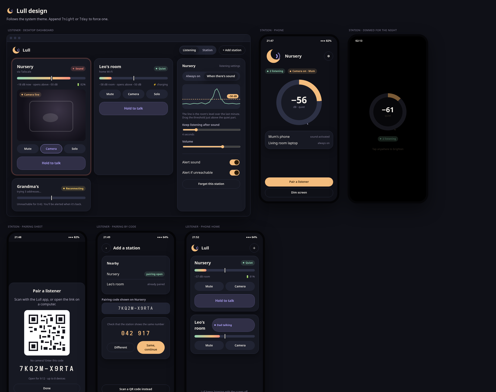

# Nestwatch design system

Open [mockups.html](mockups.html) in a browser (`?night` / `?day` to force a
theme). [nestwatch.css](nestwatch.css) is the production stylesheet for the Dioxus
desktop and web apps; Android and iOS mirror its tokens (§6).

## 1. Principles

1. **Calm at 3 a.m.** Warm, low-glare colours; no pure white on dark; motion
   only where it carries meaning (a pulsing dot while there is sound).
2. **State before controls.** Every screen answers "is my child OK, and is
   the monitor working?" before offering actions.
3. **Never rely on colour alone.** Every status pill carries a word; meters
   carry numbers; alerts carry text (NFR-A11Y-1).
4. **One hand, low light.** Primary actions sit at the bottom on phones,
   targets are at least 44 px, the hold-to-talk control is the largest
   element on a tile.
5. **Private by design is visible.** The camera indicator and "who is
   listening" are always on screen on a station.

## 2. Brand

- **Name**: Nestwatch. **Mark**: a honey crescent cradling two lavender sound
  waves ([logo.svg](logo.svg)). Minimum size 16 px; on dark and light
  surfaces alike.
- **Voice**: short, kind, specific. "Quiet", "Sound", "Reconnecting: trying 3
  addresses", not "Error 0x3".

## 3. Tokens

### 3.1 Colour

| Token | Night | Day | Use |
|-------|-------|-----|-----|
| `--ink-0` | `#0f1017` | `#faf6ef` | Page background |
| `--ink-1` | `#171923` | `#ffffff` | Cards, sheets |
| `--ink-2` | `#212433` | `#f1ece3` | Controls, inputs |
| `--ink-3` | `#2d3145` | `#e2dbcf` | Hairlines, meter tracks |
| `--text-1` | `#f3efe8` | `#22202b` | Primary text |
| `--text-2` | `#b9b4c8` | `#57536a` | Secondary text |
| `--text-3` | `#8a86a0` | `#7d7890` | Captions |
| `--honey` | `#f4bd7e` | `#b8681c` | Brand, primary action, camera |
| `--lavender` | `#b3a6ff` | `#5b4bd1` | Talk-back, focus, selection |
| `--sage` | `#93d4b4` | `#2f8a62` | Calm / connected |
| `--coral` | `#ff8f80` | `#d0473a` | Sound detected, alerts |
| `--amber` | `#ffd36b` | `#9a6a00` | Warnings: battery, reconnecting |

Each accent has a `-soft` variant (14–16 % alpha) for pill and button
backgrounds. **Dimmed** (`.dimmed`) maps everything to near-black with
desaturated warm text for a station's night mode.

### 3.2 Type

System rounded fonts first (`ui-rounded`, SF Pro Rounded, Nunito, Segoe UI
Variable), never downloaded (security.md PRIV-1). Scale: 12 / 14 / 16 / 20 /
28 / 44 px. Codes and numbers use the system monospace with wide tracking.

### 3.3 Shape, space, motion

Radii 10 / 16 / 24 px and pills. Spacing on a 4 px grid (4, 8, 12, 16, 24,
32, 48). Motion: 160 ms for controls, 600 ms for ambient changes, one shared
ease curve; all motion off under `prefers-reduced-motion`.

## 4. Components

| Component | Class | Notes |
|-----------|-------|-------|
| Card | `.card` | `.alert` adds a coral halo while a station has sound |
| Status pill | `.pill` + `.calm` `.sound` `.warn` `.voice` `.cam` | Always text + dot; `.sound` pulses |
| Button | `.btn` + `.primary` `.ghost` `.danger` `.icon` `.block` | `aria-pressed` for toggles |
| Hold to talk | `.btn.talk`, `.active` while held | Largest target on a tile |
| Level ring | `.ring` with `--level`, `--threshold` | Station hero; tick marks the strictest listener threshold |
| Level meter | `.meter` with `.fill`, `.mark` | Listener tiles; mark = this listener's threshold |
| Calibration | `.calibrate` | Last minute of room level with a draggable threshold line |
| Video | `.video` + `.badge` | 4:3, black letterbox, "Camera live" badge |
| Segmented | `.segmented` | Role switch, listening mode |
| Switch, range, input | `.switch`, `.range`, `.input`, `.code-input` | |
| Pairing | `.qr`, `.code-display`, `.verify` | |

## 5. Screens

1. **Welcome**: name, promise, choose "This device watches" (station) or
   "This device listens" (listener). Not shown again once chosen; switchable
   in settings or via the role toggle on desktop.
2. **Station**: name, listening pill(s), camera/talk indicators, level ring,
   connected listeners with their mode, "Pair a listener", "Dim screen".
3. **Station dimmed**: ring and listener count only; tap to brighten.
4. **Pairing sheet (station)**: QR, 10-character code, remaining time and
   capacity, verification number once a listener connects.
5. **Add a station (listener)**: scan QR, nearby stations with pairing open,
   code entry, verification number check, manual address for VPN use.
6. **Listener home**: grid of station tiles (desktop: 2–3 columns plus a
   settings side panel; phone: stacked tiles).
7. **Station settings (listener)**: listening mode, calibration chart,
   hold time, volume, alert toggles, forget.
8. **Camera view**: full-width video, night toggle, camera switch, talk.

## 6. Native mapping

| Token | Compose (Material 3) | SwiftUI |
|-------|----------------------|---------|
| `--ink-0..3` | `background`, `surface`, `surfaceContainer`, `outlineVariant` | asset colours `Ink0..3` |
| `--honey` | `primary` | `Color.accentColor` |
| `--lavender` | `tertiary` | `Color("Lavender")` |
| `--sage` / `--coral` / `--amber` | custom `NestwatchColors` | asset colours |
| Type scale | `Typography` with system default font | `.rounded` design system font |

Native apps keep platform conventions (navigation, sheets, switches) while
using these colours, shapes and words.
